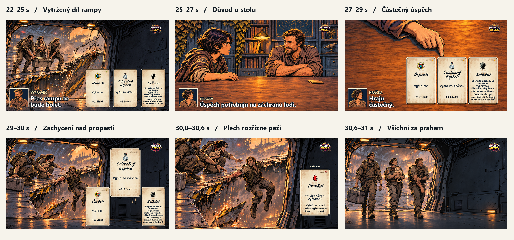

# Mighty Decks · Fangs in the Sun

Statický storyboard pro padesátisekundový trailer stolního RPG Mighty Decks v češtině a angličtině. Hráčka má poslední Úspěch: může ho použít při útěku přes bortící se rampu, nebo si ho nechat na záchranu člunu.

[Český storyboard](storyboard/storyboard-v5.png) · [English storyboard](storyboard/storyboard-en.png) · [Detail klíčové volby](storyboard/rampa-volba-dopad.png)

## Podklady

- [Scénář CS a EN](storyboard/scenar-v5.md) obsahuje časování, dialogy a kontinuitu ruky.
- [České obrazovky](storyboard/screens/cs) a [anglické obrazovky](storyboard/screens/en) jsou samostatné exporty 1920 × 1080. Po stažení projektu otevři soubor storyboard/screens/index.html pro přepínání jazyků.
- [Produkční rozhodnutí](handoff/START.md) a [kopírovatelný handoff](handoff/prompt-pro-storyboard.txt) popisují další fázi schvalování.
- [Původ referencí](reference/zdroje.md) a [katalog karet](reference/karty/texty-en-cs.json) dokumentují ilustrace a obě lokalizace.
- [Pravidla a tisk karet](https://board-game-prototypes.netlify.app/mighty-decks) jsou cílem QR kódu na závěrečném snímku.
